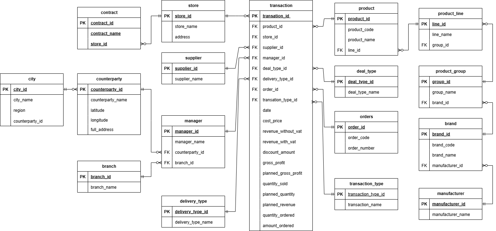
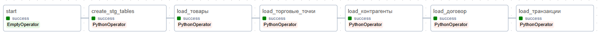
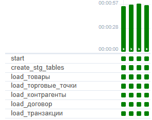
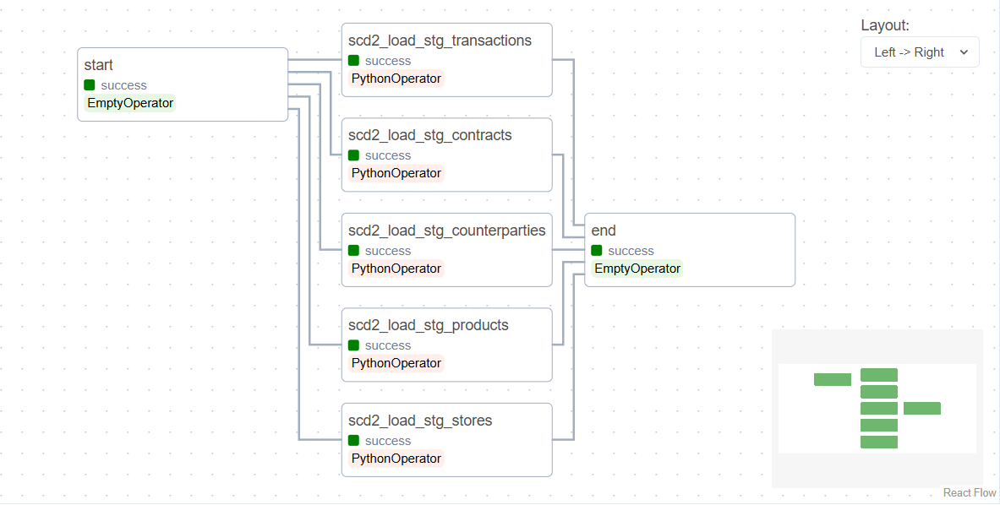
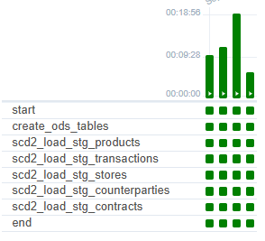
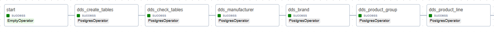
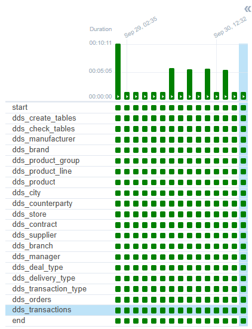

# Retail Data Warehouse ETL Pipeline

## О проекте

Проект представляет собой полнофункциональный ETL-пайплайн для построения корпоративного хранилища данных на базе **Apache Airflow**, **Python** и **PostgreSQL**.

В рамках проекта реализован полный цикл обработки данных — от загрузки исходных Excel-файлов до формирования аналитической модели данных по схеме **Snowflake**.

Архитектура построена по классической модели:

**STG → ODS → DDS**

Основное внимание уделено качеству данных, хранению историчности (SCD Type 2), автоматизации процессов и построению структуры, пригодной для аналитики.

---

# Возможности проекта

✔ автоматическая загрузка данных из Excel;

✔ оркестрация ETL-процессов с помощью Apache Airflow;

✔ проверка целостности данных с использованием MD5-хэшей;

✔ хранение истории изменений по методологии SCD Type 2;

✔ построение аналитической модели "Снежинка";

✔ контроль качества данных на всех этапах обработки;

✔ автоматический запуск последующих этапов после успешного завершения предыдущих;

✔ масштабируемая архитектура для дальнейшего развития DWH.

---

# Архитектура

Проект реализует трехслойное хранилище данных.

```
Excel Files
      │
      ▼
 STG
(Проверка данных)
      │
      ▼
 ODS
(SCD Type 2)
      │
      ▼
 DDS
(Snowflake Schema)
```



---

# Используемые технологии

| Технология | Назначение |
|------------|------------|
| Apache Airflow | Оркестрация ETL |
| Python | Обработка данных |
| Pandas | Загрузка Excel |
| SQLAlchemy | Работа с PostgreSQL |
| PostgreSQL | Хранилище данных |
| Docker | Развертывание |
| SQL | Загрузка и преобразование данных |

---

# Структура проекта

```text
etl-retail-pipeline/

├── dags/
│   ├── stg_load_with_verification.py
│   ├── ods_scd2_load.py
│   └── dds_load.py
│
├── sql/
│
├── docs/
│
├── requirements.txt
└── README.md
```

---

# ETL-пайплайн

## STG — слой загрузки данных

На первом этапе данные загружаются из Excel-файлов в staging-таблицы PostgreSQL.

### Реализовано

- загрузка данных из Excel;
- очистка STG-таблиц;
- проверка количества строк;
- вычисление MD5-хэшей;
- сравнение данных источника и базы данных;
- автоматический запуск следующего DAG.

### Airflow





---

## ODS — хранение историчности

ODS реализован по методологии **Slowly Changing Dimension Type 2**.

Для каждой изменившейся записи:

- закрывается предыдущая версия;
- создается новая версия записи;
- сохраняется полная история изменений;
- поддерживается только одна актуальная запись.

### Airflow





---

## DDS — аналитический слой

DDS построен по нормализованной схеме **Snowflake**.

Сначала загружаются независимые измерения:

- manufacturer
- brand
- product_group
- product_line

Затем зависимые измерения:

- product
- store
- supplier
- manager
- contract
- city

После этого формируется фактовая таблица **transactions**.

В таблице фактов хранятся:

- выручка;
- себестоимость;
- скидка;
- валовая прибыль;
- количество.

Для ускорения аналитических запросов созданы индексы по бизнес-ключам и внешним ключам.

### Airflow





---

# Контроль качества данных

В проекте реализована многоуровневая проверка качества данных.

### STG

- сверка MD5-хэшей;
- проверка количества строк;
- контроль успешной загрузки.

### ODS

- проверка корректности SCD Type 2;
- контроль единственной актуальной версии записи;
- проверка историчности.

### DDS

- проверка создания всех таблиц;
- контроль ссылочной целостности;
- отсутствие дубликатов;
- проверка бизнес-связей;
- проверка фактовой таблицы.

---

# Сквозное тестирование

Для проверки корректности работы всего ETL-процесса выполнено комплексное тестирование.

Проверены:

- совпадение количества записей между всеми слоями;
- корректность агрегатов;
- отсутствие потери данных;
- корректность историчности;
- отсутствие нарушений ссылочной целостности.

Результат:

- данные успешно проходят через все слои ETL;
- количество записей совпадает;
- аналитические показатели соответствуют исходным данным;
- пайплайн готов к использованию для аналитических задач.

---

# Аналитическая модель

В DDS реализована нормализованная модель данных (3НФ).

Основные измерения:

- Производитель
- Бренд
- Группа товаров
- Линейка
- Товар
- Магазин
- Контрагент
- Менеджер
- Поставщик
- Город
- Договор
- Тип сделки

Фактовая таблица:

- Transactions

Модель позволяет анализировать:

- продажи;
- прибыль;
- скидки;
- эффективность магазинов;
- эффективность менеджеров;
- продажи по брендам;
- продажи по поставщикам;
- продажи по регионам.

---

# Что демонстрирует проект

Проект демонстрирует практические навыки:

- проектирования хранилища данных;
- разработки ETL-пайплайнов;
- работы с Apache Airflow;
- реализации SCD Type 2;
- моделирования данных;
- построения Snowflake-схем;
- обеспечения качества данных;
- работы с PostgreSQL;
- автоматизации процессов обработки данных.
